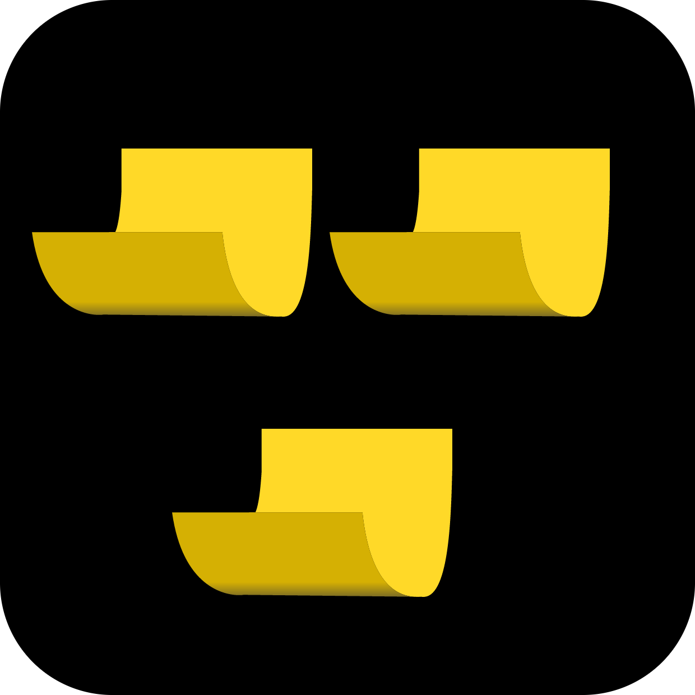

<p align="center">
  
</p>

<h1 align="center">Glass Notes</h1>

<p align="center">
  Des notes adhésives en verre plein écran, à un raccourci près — capturez vos idées partout et à tout moment<br/>
  <i>A beautiful sticky notes tool which can call out anywhere.</i>
</p>

<p align="center">
  
  
  
  
</p>

<p align="center">
  <a href="README.md">简体中文</a> ·
  <a href="README.en.md">English</a> ·
  <a href="README.es.md">Español</a> ·
  <a href="README.ja.md">日本語</a> ·
  <a href="README.ko.md">한국어</a> ·
  <a href="README.ru.md">Русский</a> ·
  <b>Français</b> ·
  <a href="README.de.md">Deutsch</a>
</p>

---

## ✨ Fonctionnalités

- **🔥 Invocation par raccourci global** — affichez ou masquez le calque de notes avec `Ctrl+Alt+Space` par défaut ; il se superpose à toutes les applications, même en plein écran. Toutes les touches modificatrices — `Ctrl` / `Alt` / `Shift` / `Cmd⌘` (Win) — sont prises en charge, et le raccourci se réenregistre dans les réglages.
- **🪟 Véritable verre dépoli** — Windows utilise l'effet Acrylic du système ; macOS propose trois effets d'arrière-plan commutables : entièrement transparent, verre liquide (`NSGlassEffectView`, macOS 26+, repli automatique sur les systèmes antérieurs) et verre dépoli NS.
- **📝 Édition Markdown WYSIWYG par blocs** — le contenu est découpé en blocs par lignes vides. Le bloc en cours d'édition affiche le Markdown brut avec coloration syntaxique en direct, tandis que les autres blocs sont rendus instantanément en texte enrichi. Prise en charge des blocs de code, des listes ordonnées / à puces / de tâches, des citations, etc. ; les cases à cocher se basculent d'un clic.
- **🗒 Disposition libre des notes** — déplacez les notes par glisser-déposer et redimensionnez-les librement ; les nouvelles notes s'alignent en cascade et les coordonnées sont ramenées dans l'écran à la restauration.
- **🌍 8 langues d'interface** — 简体中文 (par défaut), English, Español, 日本語, 한국어, Русский, Français, Deutsch.
- **🔒 Stockage entièrement local** — toutes les notes restent dans le localStorage de votre machine. Ni synchronisation cloud, ni télémétrie, ni accès réseau.
- **⚙️ Plus encore** — export en fichier en un clic, démarrage automatique en option, protection mono-instance (un second lancement réveille la fenêtre existante).

## ⌨️ Raccourcis clavier

| Action | Par défaut | Remarque |
| --- | --- | --- |
| Afficher / masquer le calque de notes | `Ctrl+Alt+Space` | Raccourci global système, personnalisable dans les réglages |
| Nouvelle note | `Ctrl+N` | Raccourci interne à l'application, personnalisable |
| En édition : scinder en un nouveau bloc | `Enter` | Le Markdown s'édite bloc par bloc ; une ligne vide sépare les blocs |
| En édition : saut de ligne dans le bloc | `Shift+Enter` | Rendu comme saut de ligne simple |
| Dans une liste : indenter / désindenter | `Tab` / `Shift+Tab` | Pour les listes à plusieurs niveaux |

## 📦 Installation

Téléchargez l'installateur de votre plateforme depuis la page **Releases** de ce dépôt :

- **Windows** : installateur / MSIX
- **macOS** : image dmg

> Les effets d'arrière-plan sous macOS reposent sur des API privées (`macOSPrivateApi`). Le niveau « verre liquide » exige macOS 26 ou ultérieur ; les systèmes plus anciens basculent automatiquement sur le verre dépoli NS.

## 🛠 Compiler depuis les sources

Prérequis : [Node.js](https://nodejs.org/) ≥ 18 et la chaîne d'outils [Rust](https://www.rust-lang.org/) stable.

```bash
cd glass-notes
npm install

npm run tauri dev     # développement avec rechargement à chaud
npm run tauri build   # construire les installateurs de publication
```

## 📁 Structure du projet

```
glass-notes/
├── package.json         # Dépendances et scripts du front ; les commandes npm s'exécutent ici
├── vite.config.mjs
├── src/                 # Sources du front (JS natif, sans framework)
│   ├── main.js          # Panneau de réglages, changement de langue, enregistrement des raccourcis
│   ├── notefunc.js      # CRUD des notes, glisser / redimensionner, export, persistance
│   ├── markdown.js      # Éditeur Markdown WYSIWYG par blocs
│   ├── language.js      # Toutes les chaînes d'interface en 8 langues
│   └── marked.esm.js    # Copie embarquée de marked
└── src-tauri/           # Backend Rust (point d'entrée : src/main.rs)
    └── src/main.rs      # Enregistrement des raccourcis globaux, fenêtre / effets de verre, adaptation plateforme
```

## 🔒 Confidentialité

Glass Notes ne collecte aucune donnée utilisateur. Les notes sont conservées uniquement dans le stockage du navigateur (localStorage) de votre machine, et l'export est toujours déclenché par vous. Voir [privacy.md](privacy.md).

## 📄 Licence

[MIT](LICENSE) © 2025 鱼香肉丝
